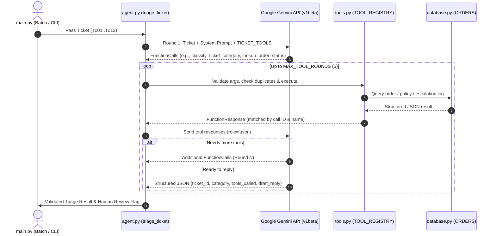

# TicketPilot — Multi-Tool Support Ticket Triage Agent

[](https://www.python.org/)
[](https://github.com/googleapis/python-genai)
[](tests/)
[](https://github.com/mdanseergit/orderpilot-ai-agent)

**TicketPilot** is an AI-powered customer support ticket triage agent built in Python using Google's Gemini API and the official `google-genai` SDK.

Developed for **Week 2 of the SkillMe AI Engineer Virtual Internship ("Multi-Tool Triage Agent")**, TicketPilot upgrades the **Week 1 OrderPilot** single-tool order assistant into a genuine multi-round, multi-tool orchestration engine while preserving full Week 1 backward compatibility.

> [!NOTE]
> **Simulation Notice:** TicketPilot is a simulated customer support triage workflow using fictional customer tickets, fictional order records (`database.py`), and an in-memory escalation log. It is **not** connected to a real e-commerce platform, live payment processor, or human ticketing system, and it never issues real refunds or contacts real people.

---

## Table of Contents

1. [What Changed from Week 1](#what-changed-from-week-1)
2. [Key Features](#key-features)
3. [Tool Descriptions & Policies](#tool-descriptions--policies)
4. [Architecture Diagram](#architecture-diagram)
5. [Multi-Round Tool-Calling & Safety Cap](#multi-round-tool-calling--safety-cap)
6. [Sample Ticket Format](#sample-ticket-format)
7. [Repository Structure](#repository-structure)
8. [Installation & Environment Setup](#installation--environment-setup)
9. [Running TicketPilot & Week 1 OrderPilot](#running-ticketpilot--week-1-orderpilot)
10. [Running Tests](#running-tests)
11. [Actual Console Output](#actual-console-output)
12. [Manual Review & Prompt Refinement Case Study](#manual-review--prompt-refinement-case-study)
13. [Known Limitations & Security Considerations](#known-limitations--security-considerations)

---

## What Changed from Week 1

| Capability | Week 1 (`OrderPilot`) | Week 2 (`TicketPilot`) |
| :--- | :--- | :--- |
| **Primary Workflow** | Interactive single-question order status lookup | Batch & structured triage of 12 multi-scenario support tickets (`tickets.json`) |
| **Available Tools** | 1 tool (`lookup_order_status`) | 3 core tools + 1 optional stretch tool (`lookup_order_status`, `classify_ticket_category`, `check_refund_eligibility`, `escalate_to_human`) |
| **Orchestration** | Single-tool request-response loop | Multi-round, multi-parallel tool calling (`agent.py`) with exact call ID matching & duplicate call prevention |
| **Safety Controls** | Iteration guard (5 iterations) | Configurable `MAX_TOOL_ROUNDS = 5` safety cap with structured warning & human-review flagging |
| **Output Format** | Free-form natural-language terminal text | Validated structured JSON (`ticket_id`, `category`, `tools_called`, `draft_reply`, `requires_human_review`) |
| **Automated Tests** | 7 tool unit tests | 19 offline unit tests (tools, multi-round mocked agent, safety-cap test, regression test) + 3 live Gemini integration tests |

All Week 1 OrderPilot capabilities remain intact and accessible via `--interactive` and `--query`.

---

## Key Features

- **Autonomous Multi-Tool Orchestration:** Gemini independently decides whether a ticket needs 1 tool (e.g., bug report), 2 tools (e.g., shipping delay), 3 tools (e.g., refund inquiry), or escalation across one or multiple rounds.
- **Parallel & Sequential Tool Execution:** Supports multiple `FunctionCall` requests within a single model response as well as follow-up rounds after inspecting initial tool results.
- **Deterministic Classification & Policy Enforcement:** Category assignment and refund eligibility rules execute strictly in Python—never guessed by the LLM.
- **Duplicate Execution Guard:** Caches `(tool_name, canonical_args)` per ticket run so identical redundant calls do not trigger duplicate side effects (such as double-counting escalations).
- **Safe Argument & Output Validation:** Inspects signatures via `inspect.signature`, rejects unknown/unregistered tools, validates final JSON payloads, and falls back gracefully on malformed outputs.
- **Rate-Limit Resilience:** Automatically retries on HTTP 429 quota responses with exponential backoff.

---

## Tool Descriptions & Policies

### 1. `lookup_order_status(order_id: str)` *(Core — Reused from Week 1)*
- Retrieves `order_id`, `customer_name`, `product`, `status`, `delivery_date`, and `delivery_iso_date` from `database.py`.
- Normalizes whitespace and casing (e.g., `" a123 "` $\rightarrow$ `"A123"`).
- Returns a structured `{"found": false, ...}` response for unknown or invalid IDs.

### 2. `classify_ticket_category(text: str)` *(Core)*
- Classifies ticket subject/body into one of four allowed categories: `billing`, `shipping`, `bug`, or `other`.
- Uses regex word-boundary matching across curated keyword sets:
  - **`billing`:** `payment`, `charged`, `charge`, `invoice`, `refund`, `transaction`, `billing`, `duplicate`, `overcharged`
  - **`shipping`:** `missing package`, `delivery`, `delivered`, `tracking`, `shipment`, `shipped`, `courier`, `package`, `transit`, `delay`, `delayed`, `arrived`, `shipping`
  - **`bug`:** `login failure`, `crash`, `crashes`, `crashing`, `error`, `broken`, `malfunction`, `malfunctioned`, `login`, `log in`, `bug`, `freeze`, `freezes`, `glitch`, `defect`
  - **`other`:** Fallback when no category keywords match or text is blank.
- **Ambiguity & Keyword Precedence:** Highest keyword match count wins; exact ties break deterministically via **`billing` > `shipping` > `bug` > `other`**.

### 3. `check_refund_eligibility(order_id: str, current_date: Optional[str] = None)` *(Core)*
Evaluates order status against a deterministic fictional policy using `SIMULATED_CURRENT_DATE = "2026-11-28"` (never issues real refunds):
- **Delivered orders:** Eligible (`eligible: true`) if delivered **within 30 days**; ineligible (`eligible: false`) after 30 days.
- **Cancelled orders:** Eligible (`eligible: true`) for automatic refund approval.
- **Processing / Shipped / Out for delivery:** Not automatically eligible (`eligible: false`); sets `requires_human_review: true`.
- **Unknown / Invalid order IDs:** Not eligible (`eligible: false`); flagged for verification.

### 4. `escalate_to_human(reason: str, ticket_id: Optional[str] = None)` *(Optional Stretch Goal)*
- Appends a simulated escalation record (`ESC-001`, `ESC-002`, ...) to an in-memory queue (`ESCALATION_LOG`).
- Explicitly notes `"simulated": true` and never claims a real human received a live notification.

---

## Architecture Diagram



---

## Multi-Round Tool-Calling & Safety Cap

1. **Multi-Round Execution:** Inside `triage_ticket()` (`agent.py`), conversation history (`contents`) preserves every model turn and tool response turn (`types.FunctionResponse` matched by `id` and `name`). Gemini can request 1 or more tools in Round 1, inspect results, request follow-up tools in Round 2+, and finish once it has all required facts.
2. **Safety Cap (`MAX_TOOL_ROUNDS = 5`):**
   - Configurable via `triage_ticket(..., max_tool_rounds=...)` or CLI flag `--max-rounds`.
   - Before executing a tool round beyond `max_tool_rounds`, the loop halts immediately, logs `[WARNING] SAFETY CAP REACHED`, sets `safety_cap_reached: true` and `requires_human_review: true`, and refuses to fabricate a successful response.

---

## Sample Ticket Format

`tickets.json` contains **12 fictional support tickets** (`T001`–`T012`) covering shipping delays, missing deliveries, cancelled-order refunds, invoice errors, duplicate charges, damaged items, app crashes, login failures, expired warranty/refund windows, general enquiries, pre-delivery refund checks, and unauthorized-charge escalations:

```json
{
  "ticket_id": "T003",
  "subject": "Refund for cancelled hub order",
  "body": "My order ORD-105 was cancelled earlier this week. Please check if I am eligible for a refund back to my original payment method.",
  "customer_email": "emma.watson@example.com",
  "order_id": "ORD-105"
}
```

---

## Repository Structure

```text
orderpilot-ai-agent/
│
├── main.py                     # CLI entry point (Week 2 batch runner + Week 1 modes)
├── agent.py                    # Multi-round Gemini loop, safety cap, JSON validation
├── tools.py                    # 3 core tools + escalation stretch tool + schemas
├── database.py                 # Mock order database with consistent ISO dates
├── tickets.json                # 12 fictional multi-scenario support tickets
├── requirements.txt            # Minimal dependencies (google-genai, python-dotenv)
├── .env.example                # Safe environment placeholder
├── .gitignore                  # Ignores .env, .venv/, __pycache__/
├── README.md                   # Documentation
│
└── tests/
    ├── test_tools.py           # Offline unit tests for all Python tools (Tests A–H)
    ├── test_agent.py           # Offline mocked multi-round & regression tests (Tests I, J, L)
    ├── test_safety_cap.py      # Offline safety-cap enforcement tests (Test K)
    └── test_integration.py     # Live Gemini API integration tests (requires API key)
```

---

## Installation & Environment Setup

1. **Clone & enter the repository:**
   ```bash
   git clone https://github.com/mdanseergit/orderpilot-ai-agent.git
   cd orderpilot-ai-agent
   ```

2. **Create and activate a virtual environment:**
   ```powershell
   # Windows
   python -m venv .venv
   .\.venv\Scripts\Activate.ps1
   ```
   ```bash
   # macOS / Linux
   python3 -m venv .venv
   source .venv/bin/activate
   ```

3. **Install dependencies:**
   ```bash
   pip install -r requirements.txt
   ```

4. **Configure `.env`:**
   ```bash
   cp .env.example .env
   ```
   Edit `.env` and add your API key from [Google AI Studio](https://aistudio.google.com/):
   ```env
   GEMINI_API_KEY=your_actual_api_key_here
   GEMINI_MODEL=gemini-3.5-flash-lite
   ```

---

## Running TicketPilot & Week 1 OrderPilot

### Run All 12 Tickets (Week 2 Default Mode)
```bash
python main.py
```
Optional flags:
- `--pace 2`: Pause 2 seconds between tickets (helpful on free-tier rate limits).
- `--max-rounds 5`: Configure the per-ticket tool-calling safety cap.
- `--tickets path/to/file.json`: Run against a custom ticket file.

### Preserved Week 1 Modes (`OrderPilot`)
```bash
# Single order query
python main.py --query "What's the status of order A123?"

# Interactive order support chat
python main.py --interactive
```

---

## Running Tests

### 1. Automated Offline Test Suite (19 Tests — No API Key Required)
Runs all tool tests, mocked multi-round agent tests, safety-cap tests, and regression tests completely offline:
```bash
python -m unittest tests/test_tools.py tests/test_agent.py tests/test_safety_cap.py -v
```

### 2. Live Gemini Integration Tests (3 Tests — Requires `GEMINI_API_KEY`)
Skips automatically if no API key is present:
```bash
python tests/test_integration.py
```

---

## Actual Console Output

Captured from executing `python -u main.py --pace 2` across all 12 tickets (`gemini-3.5-flash-lite`):

```text
===========================================================================
           TICKETPILOT — MULTI-TOOL SUPPORT TRIAGE AGENT
           Model: gemini-3.5-flash-lite | Max Tool Rounds: 5
           Tickets Loaded: 12
===========================================================================

---------------------------------------------------------------------------
[3/12] Ticket ID: T003 | Subject: Refund for cancelled hub order
---------------------------------------------------------------------------

  [ROUND 1] Gemini requested 3 tool call(s):
    -> [EXECUTED] classify_ticket_category({"text": "Refund for cancelled hub order\nMy order ORD-105 was cancelled earlier this week. Please check if I am eligible for a refund back to my original payment method."})
       Result: {"category": "billing", "reason": "Matched billing keyword(s): payment, refund.", "matched_keywords": {"billing": ["payment", "refund"]}}
    -> [EXECUTED] lookup_order_status({"order_id": "ORD-105"})
       Result: {"found": true, "order_id": "ORD-105", "customer_name": "Emma Watson", "product": "USB-C Multi-Port Hub", "status": "Cancelled", "delivery_date": null, "delivery_iso_date": null}
    -> [EXECUTED] check_refund_eligibility({"order_id": "ORD-105"})
       Result: {"order_id": "ORD-105", "found": true, "status": "Cancelled", "eligible": true, "requires_human_review": false, "refund_issued": false, "policy_rule": "cancelled_order", "reason": "Order 'ORD-105' was cancelled and is eligible for a full refund."}

  [TRIAGE RESULT]
  Ticket ID:             T003
  Subject:               Refund for cancelled hub order
  Selected Category:     billing
  Tools Called:          ['classify_ticket_category', 'lookup_order_status', 'check_refund_eligibility']
  Tool Rounds Executed:  1
  Requires Human Review: False
  Final Draft Reply:
    Hello Emma,

Thank you for reaching out to us. I have verified your order ORD-105 for the USB-C Multi-Port Hub, and I can confirm that because your order was cancelled, it is eligible for a full refund back to your original payment method. 

Please allow a few business days for the funds to reflect in your account. Let us know if you need any further assistance!

Best regards,
Customer Support Team

...

===========================================================================
                     TICKETPILOT TRIAGE SUMMARY
===========================================================================
Total Tickets Processed:   12
Successful Triage Count:   12
Failed / Warned Count:     0
Human Review Required:     6
Simulated Escalations:     6
Tool Invocation Counts:
  - check_refund_eligibility: 4
  - classify_ticket_category: 12
  - escalate_to_human: 6
  - lookup_order_status: 9
===========================================================================
```

---

## Manual Review & Prompt Refinement Case Study

During manual review of the first live 12-ticket run, we inspected every ticket's category and tool selections:

- **Original Mistake:**  
  On **T004 ("Incorrect invoice amount billed")**—where the customer asked *"I just checked my invoice for order ORD-102 and the transaction shows $20 more than the checkout total. Can you review this billing issue?"*—the agent unnecessarily invoked `check_refund_eligibility({"order_id": "ORD-102"})` in Round 2 (and similarly on **T005 "Duplicate charge on my card"**), even though neither customer asked for an order refund or return.
- **Why the Agent Made the Mistake:**  
  Rule 3 in `TICKET_SYSTEM_INSTRUCTION` and the `check_refund_eligibility` schema description did not clearly distinguish between *order refund/return inquiries* and *general billing/invoice discrepancies*. Because `order_id` was present on a billing ticket, Gemini over-applied `check_refund_eligibility`.
- **What Changed:**  
  1. Updated Rule 3 in [`agent.py`](agent.py) (`TICKET_SYSTEM_INSTRUCTION`) to state that `check_refund_eligibility` must be called **ONLY** when the customer explicitly requests a refund, return, or refund eligibility—and **NOT** for general invoice discrepancies or duplicate-charge investigations.
  2. Refined `check_refund_eligibility_declaration` in [`tools.py`](tools.py) with the same explicit negative constraint, and updated Rule 5 to route invoice overcharges/duplicate payments directly to `escalate_to_human`.
- **Verification:**  
  1. Re-ran all 12 tickets live: both **T004** and **T005** called `['classify_ticket_category', 'lookup_order_status', 'escalate_to_human']` across 2 rounds without calling `check_refund_eligibility`, while genuine refund tickets (`T003`, `T006`, `T009`, `T011`) continued calling `check_refund_eligibility` correctly.
  2. Added regression test `test_regression_t004_invoice_discrepancy_excludes_refund_check` in [`tests/test_agent.py`](tests/test_agent.py).

---

## Known Limitations & Security Considerations

- **Simulated Data & Policies:** Uses static in-memory dictionaries (`database.py`) and a fixed `SIMULATED_CURRENT_DATE = "2026-11-28"` rather than a persistent SQL/NoSQL store.
- **Keyword Classification Scope:** `classify_ticket_category` uses deterministic English keyword matching; subtle phrasing without matching keywords falls back to `other`.
- **Free-Tier API Quotas:** Models such as `gemini-3.5-flash` may enforce strict free-tier daily/minute quotas (e.g., 20 RPD); `gemini-3.5-flash-lite` with `--pace` is recommended for batch testing.
- **Security Practices:**
  - Never hardcode `GEMINI_API_KEY`; `.env` and `.venv/` are excluded via `.gitignore`.
  - Only explicit callables inside `TOOL_REGISTRY` can be invoked.
  - All tool arguments are signature-checked prior to execution.
