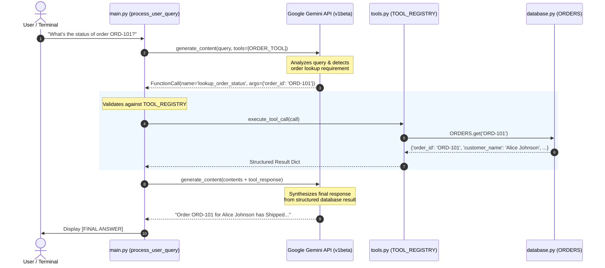

# OrderPilot — AI Order Support Agent

[](https://www.python.org/)
[](https://github.com/googleapis/python-genai)
[](LICENSE)
[](https://github.com/mdanseergit/orderpilot-ai-agent)

**OrderPilot** is a production-grade, beginner-friendly conversational AI order-support terminal agent built in Python using Google's Gemini API and the official `google-genai` SDK.

This project was built for **Week 1 of the AI Engineer Virtual Internship at SkillMe: "Your First Tool-Calling LLM Call"**. It demonstrates genuine LLM function calling (tool calling), where Google's Gemini autonomously determines when to invoke a custom Python function, receives structured return data, and synthesizes a natural-language customer response.

---

## Table of Contents

1. [Project Overview](#project-overview)
2. [Problem Statement](#problem-statement)
3. [Key Features](#key-features)
4. [What is Tool Calling?](#what-is-tool-calling)
5. [Architecture & Workflow](#architecture--workflow)
6. [Technology Stack](#technology-stack)
7. [Project Directory Structure](#project-directory-structure)
8. [Installation & Setup](#installation--setup)
9. [Configuration (.env)](#configuration-env)
10. [Usage Guide](#usage-guide)
11. [Example Queries & Terminal Output](#example-queries--terminal-output)
12. [Testing Suite](#testing-suite)
13. [Security & Best Practices](#security--best-practices)
14. [Submission Details](#submission-details)

---

## Project Overview

Traditional customer support bots rely on hardcoded decision trees or brittle pattern matching. Conversely, raw LLMs hallucinate order details because they possess no access to private operational databases.

**OrderPilot** bridges this divide. By providing Gemini with an explicit tool declaration (`lookup_order_status`), the agent:
- Understands intent from natural conversation.
- Extracts parameters (e.g., `order_id="ORD-101"`).
- Requests execution via Gemini Function Calling.
- Lets Python query the local order database.
- Feeds verified database records back to Gemini.
- Formulates accurate, empathetic, and human-like answers.

---

## Problem Statement

When building AI agents for commerce:
- **LLMs cannot access internal systems directly** without risking data corruption or arbitrary code execution.
- **Customers ask questions in varied ways** (*"Where's my package?"*, *"Check order ord-101"*, *"Did my chair ship yet?"*).
- **Agents must never guess:** If an order does not exist or an ID is missing, the agent must ask for clarification rather than hallucinate.

OrderPilot solves this by enforcing an explicit, guarded tool-calling pipeline.

---

## Key Features

- **Genuine Gemini Function Calling:** Uses the official `google-genai` SDK and `FunctionDeclaration` schema. No third-party agent wrappers or simulated responses.
- **Enriched Mock Database:** Covers diverse e-commerce statuses: `Processing`, `Shipped`, `Out for delivery`, `Delivered`, and `Cancelled`, complete with customer names, product titles, and delivery dates.
- **Tool Registry Security:** Strictly matches requested function names against an explicit dictionary (`TOOL_REGISTRY`) to guard against arbitrary execution.
- **Input Normalization:** Strips whitespace and normalizes order IDs (e.g., lowercase `ord-101` maps to `ORD-101`).
- **Missing Information Prompting:** If a customer asks *"Where is my order?"*, the agent politely prompts for their order ID instead of guessing.
- **Robust Error & Rate-Limit Handling:** Catches API 429 quota limits and automatically retries with exponential backoff.
- **Dual Testing Strategy:** Includes 100% offline unit tests with mocked Gemini responses as well as live end-to-end integration tests.

---

## What is Tool Calling?

**Tool Calling** (Function Calling) enables an LLM to interact with external tools, APIs, and databases:

1. **Schema Description:** The host program describes available tools to Gemini using JSON Schema (`name`, `description`, `parameters`).
2. **Intent & Decision:** The LLM inspects the user message. If an external tool is required, it returns a structured `FunctionCall` containing the function name and arguments.
3. **Host Execution:** The LLM does **not** run code itself. The Python application receives the request, safely executes the function, and obtains a structured dictionary.
4. **Tool Response Turn:** Python delivers the tool result back to Gemini under `role='user'` using `types.Part.from_function_response(...)`.
5. **Final Synthesis:** Gemini reads the verified tool output and composes the final answer.

---

## Architecture & Workflow



---

## Technology Stack

- **Language:** Python 3.10+ (tested on Python 3.13.7)
- **SDK:** Official `google-genai` (v3.6.1+)
- **Environment Management:** `python-dotenv` (v1.2.4+)
- **LLM Provider:** Google Gemini API (`gemini-3.5-flash`, configurable)
- **API Version:** Google GenAI `v1beta`
- **Testing:** Python standard library `unittest` and `unittest.mock`

---

## Project Directory Structure

```text
orderpilot-ai-agent/
│
├── .venv/                      # Isolated virtual environment (ignored by git)
├── .vscode/
│   └── settings.json           # VS Code Python interpreter configuration
│
├── .env                        # Local secret API credentials (ignored by git)
├── .env.example                # Safe environment template for version control
├── .gitignore                  # Git ignore rules (.env, .venv, pycache)
│
├── database.py                 # Mock database containing rich order records
├── tools.py                    # Tool function, Gemini FunctionDeclaration & TOOL_REGISTRY
├── main.py                     # Agent loop, terminal interface, error handling & CLI
├── requirements.txt            # Minimal required dependencies
├── README.md                   # Complete architectural documentation
│
└── tests/
    ├── test_tools.py           # 100% offline unit tests with mocked Gemini calls
    └── test_integration.py     # Live Gemini API end-to-end integration tests
```

---

## Installation & Setup

### 1. Clone the Repository

```bash
git clone https://github.com/mdanseergit/orderpilot-ai-agent.git
cd orderpilot-ai-agent
```

### 2. Create and Activate Virtual Environment

**On Windows:**
```powershell
python -m venv .venv
.\.venv\Scripts\Activate.ps1
```

**On macOS / Linux:**
```bash
python3 -m venv .venv
source .venv/bin/activate
```

### 3. Install Dependencies

```bash
pip install -r requirements.txt
```

---

## Configuration (.env)

1. Obtain a free Gemini API key from [Google AI Studio](https://aistudio.google.com/).
2. Copy the `.env.example` file to `.env`:
   ```bash
   cp .env.example .env
   ```
3. Set your API key in `.env`:
   ```env
   GEMINI_API_KEY=AIzaSyYourActualKeyHere
   GEMINI_MODEL=gemini-3.5-flash
   ```

> [!CAUTION]
> Never commit `.env` or expose API keys. Both `.env` and `.venv/` are listed in `.gitignore`.

---

## Usage Guide

### 1. Interactive Terminal Mode
Start the continuous interactive support session:

```bash
python main.py
```

### 2. Single Query Mode
Execute a one-off query directly via command-line arguments:

```bash
python main.py "What is the status of order ORD-101?"
```

---

## Example Queries & Terminal Output

### Known Order Lookup
```text
Enter your question: What is the status of order ORD-101?

[AI] Analyzing your request...

[TOOL CALL]
Function:  lookup_order_status
Arguments: {
  "order_id": "ORD-101"
}

[TOOL EXECUTION]
Result:    {
  "found": true,
  "order_id": "ORD-101",
  "customer_name": "Alice Johnson",
  "product": "Wireless Noise-Canceling Headphones",
  "status": "Shipped",
  "delivery_date": "Tomorrow by 2:00 PM"
}

[FINAL ANSWER]
Order ORD-101 for Alice Johnson (Wireless Noise-Canceling Headphones) is currently Shipped. It is scheduled to be delivered Tomorrow by 2:00 PM.
-----------------------------------------------------------------
```

### Unknown Order Handling
```text
Enter your question: Where is order XYZ999?

[AI] Analyzing your request...

[TOOL CALL]
Function:  lookup_order_status
Arguments: {
  "order_id": "XYZ999"
}

[TOOL EXECUTION]
Result:    {
  "found": false,
  "order_id": "XYZ999",
  "message": "Order 'XYZ999' was not found in our database."
}

[FINAL ANSWER]
I'm sorry, but order 'XYZ999' was not found in our database. Please double-check your order number.
```

### Missing Order ID Prompting
```text
Enter your question: Where is my order?

[AI] Analyzing your request...

[FINAL ANSWER]
Please provide your order ID so I can check its current status for you.
```

---

## Testing Suite

### 1. Offline Unit Tests (Zero API Key / Zero Cost)

These tests use `unittest.mock` to simulate the Gemini API responses, allowing deterministic, instant execution in CI/CD without making external network calls:

```bash
python -m unittest discover -s tests -p "test_tools.py"
```

**Results:**
```text
.......
----------------------------------------------------------------------
Ran 7 tests in 0.023s

OK
```

**Tests Executed:**
1. `test_1_valid_order_id`: Validates structured retrieval for valid orders and casing (`ORD-101`, `ord-101`, `A123`).
2. `test_2_unknown_order_id`: Validates structured not-found response for `XYZ999`.
3. `test_3_invalid_or_empty_order_id`: Validates rejection of empty strings, whitespace, non-strings, and `None`.
4. `test_4_multiple_order_lookups`: Validates independent retrieval across multiple records.
5. `test_5_gemini_tool_calling_integration_mocked`: Validates the full two-turn tool execution loop using `unittest.mock`.
6. `test_execute_tool_call_safety`: Validates rejection of unregistered function execution.
7. `test_schema_and_registry`: Validates `FunctionDeclaration` schema compliance.

### 2. Live Gemini Integration Tests

Executes 6 live scenarios against Google's Gemini API:

```bash
python tests/test_integration.py
```

---

## Security & Best Practices

- **Zero Hardcoded Secrets:** Keys are injected strictly via environment variables.
- **Guarded Registry Execution:** Only explicitly mapped tools in `TOOL_REGISTRY` can be executed. Unregistered function calls from the model are blocked.
- **Fail-Fast Configuration:** If `GEMINI_API_KEY` is missing, the application terminates immediately with a helpful error message instead of failing silently.
- **Bounded Tool Iterations:** A maximum recursion limit (5 turns) prevents infinite loops.

---

## Submission Details

- **Internship:** SkillMe AI Engineer Virtual Internship
- **Week:** 1 — Your First Tool-Calling LLM Call
- **Repository:** [https://github.com/mdanseergit/orderpilot-ai-agent](https://github.com/mdanseergit/orderpilot-ai-agent)
- **Author:** Mohammed Danseer
